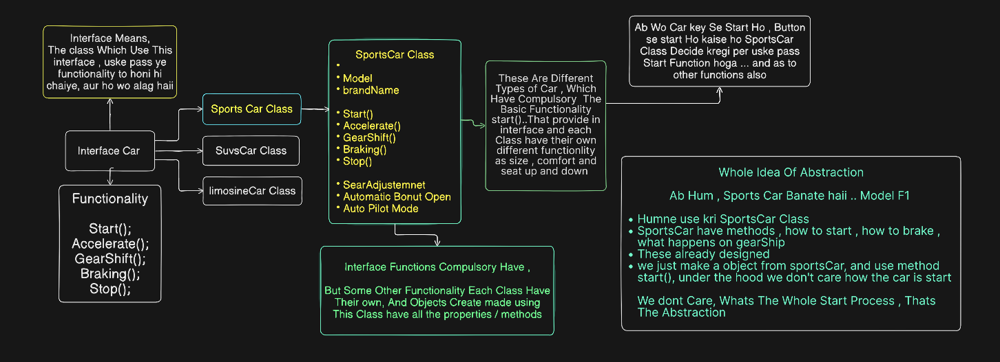

# Abstraction

We Call Four Pillar of OOPs , Abstraction one of that 
- Abstraction

Abstraction Hides Unnecessary Details from a client & showcase only What is necessary;<br>
This Can be understand By a Class , but we not understand , so Understand As a backend Dev

```javascript
const user = await User.findOne({ email });
```

 Whats Abstraction in This , what mongoose hides from us..
- thats a normal Query To Fetch User , but we dont care what mongoose do to fetch this user ..

### Mongoose Do
```
open TCP connection
create MongoDB protocol message
send request
wait for response
parse BSON
handle connection pool
...
```
We Dont Care of This , Mongoose just provides a high-level API that hides the lower-level database/driver operations from our application code.,,,, Thats Abstraction
```
# We only cares
WHAT I WANT
     ↓
find a user
     ↓
User.findOne(...)

We Dont Care How It is Actually Perform
```

Thats The Best Example For developer To understand Abstraction
## Lets Now Take A OOPs Example

