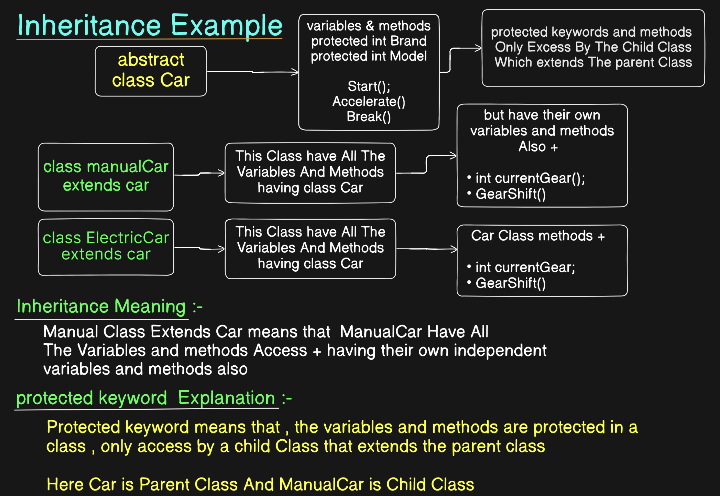

# Inheritance
A child class can acquire properties and methods from a parent class and then add or customize its own behavior.

Look on Inheritance.java Code , if Object Made By parent Class and the variables are protected than , make a object and access the variables by getter,setter , but not directly , if variables are protected

But Another Class which Inherit the Parent Class , if its variables are protected but the child class has the access To the protected keywords , directly lookin inheritance.java code

# Polymorphism 

Polymorphism in Java allows a single method or object to take multiple forms, enabling flexible and reusable code through method overloading and overriding

**Definition:-** 
Polymorphism, derived from Greek words meaning "many forms," is a core concept of Object-Oriented Programming (OOP) that allows the same method or object to behave differently depending on the context or object type. It enhances code flexibility, maintainability, and reusability by allowing objects to be treated as instances of their parent class or interface while executing subclass-specific

Two Types of Polymorphism:-
- 1) Dynamic Polymorphism - Overiding the methods
- 2) Static Polymorphism - overloading of method