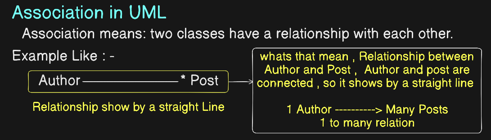
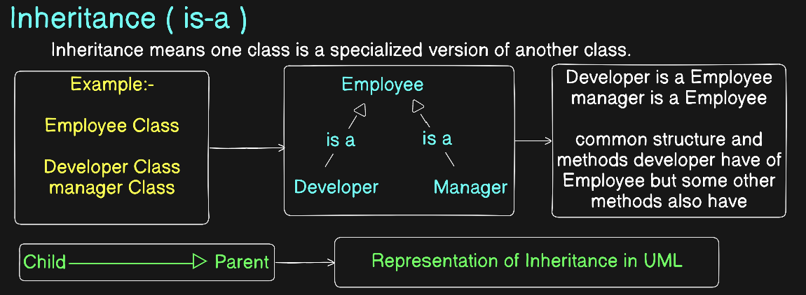
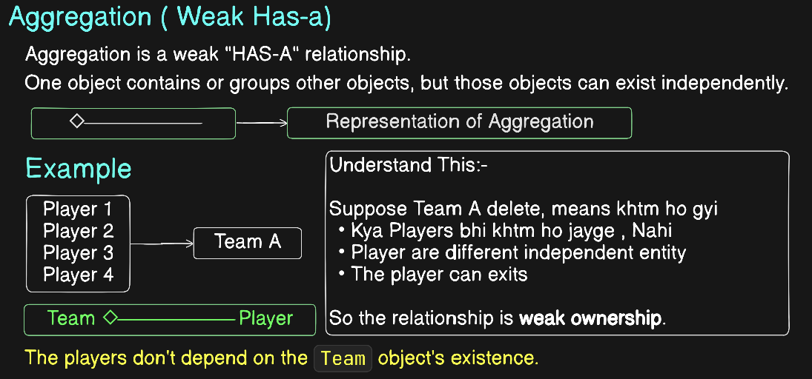
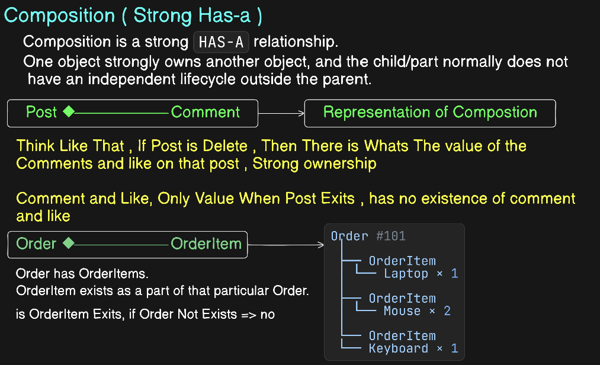

# UML Diagram (Unified Modeling Language)

```
                         UML
              Unified Modeling Language
                         │
          ┌──────────────┴──────────────┐
          │                             │
      STRUCTURE                     BEHAVIOR
   "What exists?"                "What happens?"
          │                             │
          ▼                             ▼
    CLASS DIAGRAM                SEQUENCE DIAGRAM
          │                             │
          │                       Object interactions
          │                       Who calls whom?
          │
    ┌─────┴─────────────────────────────┐
    │                                   │
  CLASS                              RELATIONSHIPS
    │                                   │
    ├── Attributes                      ├── Association
    ├── Methods                         │    User ── Order
    └── Visibility                      │
        + public                         ├── Inheritance
        - private                        │    Admin ─▷ User => is-a
        # protected                      │
                                         ├── Composition
                                         │    Order ◆── OrderItem => Strong has-a
                                         │
                                         ├── Aggregation
                                         │    Team ◇── Player  => weak has-a
                                         |
                                         |--- Department ◇──────── Employee
                                         │
                                         └── Dependency
                                              Service - - → Gateway


                 OTHER UML DIAGRAMS
                         │
          ┌──────────────┼──────────────┐
          ▼              ▼              ▼
      USE CASE        STATE          ACTIVITY
      "What can       "What states   "What is the
       user do?"       exist?"        workflow?"
```

## Association



## Inheritance



## Aggregation




## Composition



